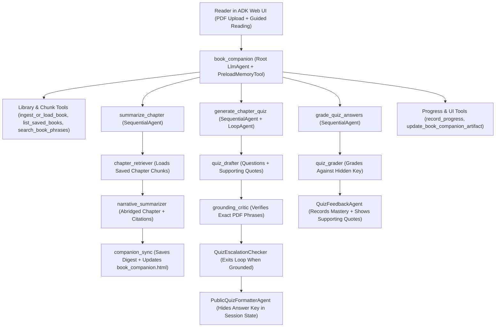

# BookCompanion: Interactive Summarized-Book & Mastery Agent

**Track:** Agents for Good (Education) | **Framework:** Google Agent Development Kit (ADK Python)

## Problem & Solution

Reading dense textbooks, technical papers, and long non-fiction books passively leads to unfinished chapters and low retention, while manually distilling notes and self-tests takes hours. **BookCompanion** turns any long PDF into an interactive, **abridged book-reading experience**: it parses and saves the book by chapter and phrase boundaries once, guides you chapter-by-chapter with readable narrative digests and cited author quotes, and weaves lightweight comprehension check-ins that adapt to your weak spots across sessions.

---

## User Experience: Reading Like a Summarized Book

Instead of behaving like an open-ended Q&A chatbot where the reader has to invent prompts, BookCompanion structures every interaction around a natural **guided reading flow** inside the built-in **ADK Web UI**:

1. **One-Time Upload & Saved Bookshelf:** Attach a PDF in ADK Web (or pick a previously uploaded title from your saved bookshelf). If the book was already processed, its saved chapter map and chunks load instantly without re-parsing.
2. **Book Cover & Interactive Table of Contents:** Presents an executive **Book Overview** (core thesis, key themes, estimated reading time) alongside a chapter roadmap showing your live reading bookmark (`Done`, `Reading Now`, `Up Next`).
3. **Chapter-by-Chapter Narrative Digests:** Reads like a well-edited abridged book rather than dry bullet fragments:
   * **The Big Idea:** Flowing narrative summary of the chapter's argument.
   * **Key Passages:** Verbatim phrases quoted from the author with exact `[Chapter X, p. Y]` citations.
   * **Effortless Page-Turning Footer:** Every chapter ends with simple next actions—reply `"next"` to turn to the next chapter, `"deep dive"` to unpack a specific passage, or `"check-in"` for a quick 2-question reflection quiz.
4. **Live Book Companion Reader (ADK Web Artifact):** As you progress, the agent incrementally compiles your read chapters, highlighted quotes, and quiz takeaways into a clean, book-styled HTML edition (`book_companion.html`) viewable anytime in ADK Web's **Artifacts** pane.

---

## System Architecture

### 1. Multi-Agent Orchestration & Grounded Logic

A root coordinator (`book_companion`) manages reader pacing, bookshelf selection, and bookmark state while delegating heavy lifting to three deterministic ADK workflow `AgentTool` pipelines:

* **`summarize_chapter` (`SequentialAgent`):** `chapter_retriever` pulls ordered chunks for the active chapter, `narrative_summarizer` composes an engaging abridged chapter strictly grounded in `[p. X]` citations, and `companion_sync` persists the digest, advances the bookmark, and refreshes the reader's `book_companion.html` artifact.
* **`generate_chapter_quiz` (`SequentialAgent` wrapping `quiz_verification_loop` `LoopAgent`):** `quiz_drafter` creates 2 comprehension questions plus a hidden answer key, `grounding_critic` verifies every answer against exact phrases in the saved chapter chunks before `QuizEscalationChecker` exits the loop, and `PublicQuizFormatterAgent` publishes only a quiz that passed grounding, keeping its answer key in `session.state["active_quiz_key"]`.
* **`grade_quiz_answers` (`SequentialAgent`):** `quiz_submission_loader` stages the reader's reply, `quiz_grader` grades it against the hidden answer key, and `QuizFeedbackAgent` records per-topic mastery in the progress store and renders per-question results with supporting quotes. The root agent's instruction never contains the answer key.

Each pipeline step that cannot continue sets `session.state["pipeline_error"]`; downstream steps skip via `before_agent_callback`, because `SequentialAgent` does not stop on `escalate`.



### 2. Persistent Chapter & Phrase Chunking + Tool Design

To handle long books without context overflow or repeated parsing latency, PDF ingestion is decoupled into a **content-addressed persistent store** exposed through strongly typed ADK `FunctionTool` interfaces:

* **2-Level Chapter & Phrase-Boundary Chunker (`pymupdf`):**
  * **Macro-Level (Chapters & Sections):** Extracts embedded PDF bookmarks (`doc.get_toc()`) first, falling back to font-size ratios and heading patterns (`Chapter 3`, `2.1 Methods`) when outlines are absent.
  * **Micro-Level (Phrase-Safe Packing):** Splits within each chapter along paragraph (`\n\n`) and natural sentence/clause boundaries (`. `, `? `, `! `, `; `, `—`)—never slicing mid-phrase. Packs complete sentences into 350–450 token chunks with a **2-sentence sliding overlap** so cross-sentence context stays intact.
* **Persistent Chunk Storage (Chunk Once, Read Anytime):**
  * Computes a `SHA-256` content fingerprint (`doc_id`) on upload and persists `toc.json` (chapter titles, page spans, chunk counts) and `chunks.json` (chunk text, chapter IDs, page ranges) to disk (`~/.cache/book_companion/library_store/<doc_id>/` by default, configurable via `BOOK_COMPANION_STORE_DIR`).
  * Re-opening a book in a later session bypasses PDF extraction completely and loads the saved chapter index in milliseconds.
* **Tool Interfaces & Guardrails:**

| Tool | Responsibility |
| :--- | :--- |
| `ingest_or_load_book` | Hashes uploaded PDF from ADK `ArtifactService` (or local path), loads cached chunks on hit, or runs the 2-level chunker and persists the index on miss. |
| `list_saved_books` | Returns previously indexed books along with the reader's last bookmarked chapter and mastery percentage. |
| `get_chapter_chunks` | Streams saved chunks and page metadata for a target `chapter_id` to power abridged chapter reading. |
| `search_book_phrases` | Runs BM25 phrase and keyword retrieval (scoped to a chapter or across the full book) for `"deep dive"` questions and citation checks. |
| `record_progress` | Records a concept the reader demonstrated (or missed) outside a check-in; quiz results are recorded by `grade_quiz_answers` itself. |
| `update_book_companion_artifact` | Renders and saves `book_companion.html` into ADK `ArtifactService` with typography-styled chapter summaries, quotes, and progress bars. |

* **Safety & State Hygiene:** A `before_tool_callback` rejects path traversal and non-PDF sources and caps `search_book_phrases` at 8 chunks; the chunker reports encrypted or image-only PDFs with clear user feedback; and quiz answer keys live only in `session.state["active_quiz_key"]`, which the root prompt never renders and only the grading pipeline reads. Chapter text and other pipeline scratch values use ADK's `temp:` state scope, so they never enter persisted session history.

### 3. Context Management & Cross-Session Memory

* **Active Reading Session State (`session.state`):** Tracks `active_book_id`, `doc_toc`, `active_chapter_id` (the chapter last presented, used for check-ins and deep dives), `bookmark_chapter_id` (the next unread chapter), and `active_quiz_key`, paired with ADK's token-based `EventsCompactionConfig` so multi-chapter reading marathons never hit token limits. Key names live in `app/state.py`.
* **Persistent Reader Profile (Progress Store & Memory Bank):** The `LibraryStore` progress files are the single source of truth for bookmarks and mastery; session state is a derived view refreshed through `reader_state_delta()`. `PreloadMemoryTool` + `after_agent_callback` (`add_session_to_memory`) make past sessions available to the model when a `MemoryService` is configured, and `record_progress` surfaces `weak_topics_to_review` so the coach can revisit missed concepts.

### 4. Evaluation, Observability & Tracing

* **Distributed Tracing & Telemetry:** ADK's built-in OpenTelemetry instrumentation (exported to Cloud Trace via `otel_to_cloud=True` in `fast_api_app.py`) records agent delegation, loop iterations, and tool calls, so each chapter retrieval and grounding check is inspectable end-to-end.
* **Automated Quality Gate (`agents-cli eval`):** Evaluates both deterministic structural guardrails (`book_companion_guardrails` verifying `[p. X]` citations and anti-spoiler quiz formatting) and LLM-judged rubric criteria (`custom_response_quality` checking groundedness, narrative readability, and bookshelf onboarding) against fixture PDFs.

### 5. Infrastructure & CI/CD Lifecycle

* **Local-First Prototyping:** Managed with `uv` and `agents-cli`, tested interactively via `agents-cli playground` (ADK Web UI) and `pytest` unit/integration tests covering the hierarchical chunker, persistent cache store, BM25 phrase searcher, and FastAPI/A2A routes.
* **Cloud Promotion & CI/CD (next phase):** The `agents-cli` scaffold supports promotion to Vertex AI Agent Runtime or Cloud Run with Terraform and CI pipelines via `agents-cli scaffold enhance`; this prototype currently ships with `deployment_target: none` and swaps `LibraryStore` for GCS/Firestore at that point.

---

## Project Structure & Quick Start

```text
app/
├── agent.py                  # Root book_companion Agent and ADK App
├── prompts.py                # Root and sub-agent instruction templates
├── callbacks.py              # Reader-state bootstrap, memory sync, before_tool_callback guardrails
├── tools.py                  # Typed FunctionTools (blocking work offloaded via asyncio.to_thread)
├── state.py                  # StateKey constants + progress-to-session-state projection
├── runtime.py                # Shared LibraryStore, model factory, companion HTML renderer
├── workflows/
│   ├── steps.py              # Deterministic BaseAgent steps + pipeline short-circuit callbacks
│   ├── digest.py             # summarize_chapter pipeline
│   └── quiz.py               # generate_chapter_quiz and grade_quiz_answers pipelines
├── fast_api_app.py           # ADK Web / SSE / A2A FastAPI entrypoint with OTel tracing
└── library/
    ├── models.py             # Typed Pydantic domain schemas (TOC, chunks, mastery, quizzes)
    ├── chunker.py            # 2-level chapter & phrase-boundary PDF chunker (PyMuPDF)
    ├── store.py              # Content-addressed SHA-256 persistent library & bookmark store
    ├── search.py             # Okapi BM25 + contiguous phrase/bigram passage searcher
    └── companion_renderer.py # Self-contained serif HTML renderer for book_companion.html
```

```bash
# Launch the built-in ADK Web UI locally
agents-cli playground

# Run unit and integration tests
uv run pytest tests/unit tests/integration -v

# Run automated evaluation suite
agents-cli eval run
```
